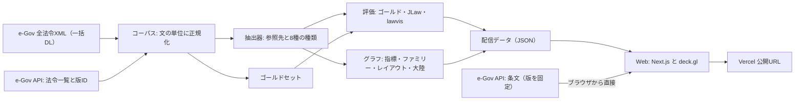

# 法令アトラス（仮）: 日本の全法令の参照ネットワーク可視化

## ゴール

日本の施行中の全法令を、参照でつながった1枚の地図として見せる Web 作品を作る。眺めて面白く、調べものにも使え、精度を公開しているので信頼できる、という3つを同時に満たし、lawvis（可視化法学）を圧倒的に超える。各マイルストーンの終わりに、外部から開けることを確かめた公開URL（Vercel）で確認してもらう。

## 調査と検証で分かったこと

実際に API とデータを取って確かめた（詳細は `specs/verified-facts.md`）。

- e-Gov の法令API の「9,576件」は廃止法令などを含む数で、いま施行中なのは 9,015件（うち未施行の新法12件）。地図の対象はこの 9,015件とし、廃止法令は参照されている場合だけ「ゴースト」として薄く描く。
- 全法令XMLの一括ダウンロードは約300MB で、数秒で取れる。現行版は 9,005件入っていて、残りは API で補える。本則の条は約24万、附則は約16万。
- e-Gov の API は CORS を許可していて、条1つを約0.3秒で返す。版を指定すれば、抽出したときと同じ本文が取れる。ただし改正法由来の附則は個別に取れないので、附則の参照はデータ側に前後の文脈を持たせる。
- lawvis の50分野のデータを全部取って合わせると、8,685法令・113,641ペアだった。分野ごとに別の図で、線に種類も重みもなく、本文も出ない。
- JLaw-CiteGraph は 8,998法令・70,577ペアのデータと、精度の評価サンプルを CC BY 4.0 で公開している。参照の種類は4つ（引用・委任・別表・改正）で、探索の画面は1法令を中心にした図だけ。
- 法脈は委任や改正を区別した種類つきの図を出しているが、公開デモは1法令を中心にした図で、全体の地図も精度の公開もない。
- 法令番号つきの参照（「民法（明治二十九年法律第八十九号）」の形）だけを数える試作で、法令ペアが 59,305組取れた。略称・「同法」・法令名だけの参照を足せば、JLaw の規模を超えられる見込み。
- 既存の Vercel チームでは、デプロイ固有のURLにはログインが必要で、本番のエイリアス（`○○.vercel.app`）は誰でも開ける。共有するのは本番のエイリアスにする。公開には Vercel のトークンが要る（下の「お願いしたいこと」）。

## 差別化の軸

lawvis だけでなく、データでは強い JLaw-CiteGraph と、種類つきの図を持つ法脈も超えることを目標にする。

- 1枚の地図: lawvis は50枚に分かれ、法脈と JLaw は1法令を中心にした図しかない。本作は 9,015件を1枚に置き、e-Gov の50分野を13のまとまりに分けた「大陸」として描く。分野をまたぐ参照は、大陸の間の流れとして束ねて見せる。
- 途切れないズーム: 分野、法令、条の順に、同じ画面のまま降りていける（条はM3）。条は法令の円の中に、条文の順番どおりに並べる。
- 参照の意味: 参照を8種に分ける。制定の根拠、委任の受け皿、改正・廃止、準用、例による、適用除外、定義・用語の借用、引用。読替えを伴うかどうかと、本則・制定文・別表・附則（制定時）・附則（改正法から）の5つの部も区別する。lawvis は種類なし、JLaw は4種。さらに、法律とその施行令・施行規則を「法令ファミリー」としてまとめ、委任の連なりを地図の上で追えるようにする。
- その場で読める: 参照の箇所をクリックすると、e-Gov からその版の条文を取り、言及している語句を強調して見せる。他の3つにはない。
- 時間: 明治5年から現在までの成長の再生と、2018年以降の年ごとの参照の増減（M4）。
- 信頼性: 自前のゴールドセット（300文、うち100文を二重注釈）、JLaw が公開した評価サンプル、lawvis と JLaw との法令ペアの突き合わせ（差を原因別に分類）の3つで精度を測り、公開する。ここまでやっている先行例はない。
- 手触り: emil-design-eng の指針に従い、何度も使う操作は動かさず即座に反応させ、動かすのは位置が変わる場面だけにする。全エッジを GPU で描き、フィルタも GPU で切り替えるので、絞り込みが待たずに効く。

## 構成

- パイプラインは TypeScript（Node 22）。XML は e-Gov の API と同じ形の木に直してから文を取り出す。この取り出し方は Web と同じ実装を共有するので、地図で示した箇所と e-Gov の本文が必ず一致する。
- 抽出は決定的な規則だけで作る（LLM は使わない）。再現でき、評価を公開できるようにするため。
- レイアウトは、まず50分野の位置を決め、各法令を自分の分野に引き寄せながら参照でつながった法令どうしを近づける（ForceAtlas2）。重なりを除いたあと、法令の密度の等高線から大陸の形を作る。円の大きさは条文の数（法令の「面積」）にする。
- Web は Next.js 16 と deck.gl 9.4。エッジは分野の重心を通る曲線に束ね、描画とフィルタを GPU で行う。日本語のラベルは重ならないように、重要な法令から順に出す。
- 配信データは JSON で、初回に読むのは圧縮後3MB以内。法令ごとの参照箇所は、選んだときに読む。

## マイルストーンと受け入れ条件

1. データ基盤と抽出器（M1）
   - コーパス: 施行中の全法令に本文がある。30条を無作為に選び、e-Gov API の本文と1文字残らず一致する。
   - 抽出器: 他法令への参照の法令単位で F値0.95以上（適合率0.97以上、再現率0.93以上）。条まで含めて F値0.90以上。種類の正しさ0.90以上。JLaw の評価サンプルとの一致95%以上。法令名らしい言及の未解決が3%以下。全件の処理が20分以内。
   - 評価: ゴールドセット300文と二重注釈がそろい、lawvis と JLaw との突き合わせの差が原因別に分類されている。精度と比較の結論を1段落で言える評価レポートがある。
2. アトラス v1 の公開（M2）
   - 全法令の地図に50分野の大陸が出る。法令ペアは55,000以上。法令の85%以上が自分の分野の大陸の中にある。
   - 検索: 「みんぽう」で民法が1位、「平成15年法律第57号」で個人情報の保護に関する法律が1位。
   - 詳細パネル: 参照している/されている法令の一覧、法令ファミリー、参照箇所の本文（e-Gov から1秒以内）と語句の強調。
   - フィルタ（種類・部・法令種別・最小の言及数）がすぐ効き、URLで共有でき、再読み込みで戻る。
   - キーボードだけで使え、`prefers-reduced-motion` ではカメラが動かない。モバイルでは下からのシートになる。
   - 公開URLが認証なしで開け、初回の表示が2.5秒以内（デスクトップ）。仮データの段階で一度公開し、本物のデータで公開し直す。
3. 条文レベル（M3）
   - 法令を拡大すると、その中に条が条文の順に並び、章ごとに色が分かれる（民法なら1,000以上の条）。
   - 条を選ぶと本文と、その条を参照している他の法令の条（逆引き）が出る。
   - 影響範囲: 1〜3段先までの参照先・参照元を数とともに強調する。
   - 経路探索: 2つの法令を選ぶと最短のつながりを示し、各段の根拠の文を出す。
   - 語句マップ: 語句を入れると、その語句が出てくる法令が地図の上で順に光る（e-Gov のキーワード検索。1ページ約20秒かかるので、届いた分から光らせる）。
   - 定義語の借用（「○○法第二条に規定する△△」）を一覧で見られる。
4. 時間軸（M4）
   - 成長の再生: 現行法令を公布日順に、明治5年から今まで地図の上に現していく（「今も生きている法令が生まれた順」であることを明記する）。
   - 年ごとの差分: 2018年から毎年1月1日の版を取り、参照の増減を比べる。「この年に最も変わった法令」の上位20件と、増えた・減った参照の例を出す。参照先が廃止された参照を警告として出す。
   - e-Gov への問い合わせは2万件以内、1秒に2件以内で、結果を保存して再利用する。
5. 物語と仕上げ（M5）
   - ガイドツアー（5〜7か所）: 最大のハブ（地方自治法など）、委任の滝（租税特別措置法 → 施行令 → 施行規則）、どこからも参照されない法令の多さ、分野をまたぐ橋（行政手続法など）、明治の布告が今も生きていること。
   - 法令ごとの OGP 画像と、法令を指すURL。
   - 手法とデータのページ: 評価の結果、誤りの分類、データのダウンロード（CC BY 4.0、e-Gov の出典つき）。
   - 性能（デスクトップで60fps）、アクセシビリティ、モバイルの仕上げ。lawvis との比較チェック（全項目で上回ることを確かめる）。

## 進め方

- 最初に4つの実装を同時に起動する: コーパス（`m1-01`）、抽出器（`m1-02`。コーパスができるまでは規則とテストを先に作る）、評価（`m1-03`。外部データと評価の道具を先に作る）、UI（`m2-02` と公開の `m2-03`。仮データで先に作る）。グラフとレイアウト（`m2-01`）は、抽出器が最初の全件の結果を出したら起動する。
- 実装は Grok 4.6 の担当が行う。仕様は `specs/` にあり、判断の必要なところは決めてある。計画とレビューは Opus 5.5 が担当し、各マイルストーンの終わりに、受け入れ条件の確認と、画面の動きのレビュー（emil-design-eng の書式）を行う。
- 評価の独立性のため、ゴールドセットを作る担当は抽出器の規則と出力を見ない。二重注釈の2人目は別のモデルで起動する。
- 保存先: ソースは GitHub リポジトリ `n1n9-jp/japan-law-atlas`（`web/` `pipeline/` `shared/`）。生成データ（コーパス・参照・配信 JSON）は Context の `data/`。`node_modules` と生の XML は置かない。
- 公開: 既存の Vercel チーム（dataviz 系と同じ）に `hourei-atlas` プロジェクトを作る。共有するのは本番のエイリアス（`hourei-atlas.vercel.app` の予定）。
- 進み具合は `notes.md` で追う。

## お願いしたいこと

- Vercel のアクセストークンを作り、Cursor のダッシュボード（Cloud Agents → Secrets）に `VERCEL_TOKEN` として追加してください。スコープは、dataviz 系のプロジェクトがあるチーム（`n1n9jps-projects`）です。これがないと公開できません。データの準備と UI の開発は、トークンを待たずに進めます。

## リスクと対策

- 公開できない: トークンがないと Vercel に出せない（この環境の Vercel 連携は、数十MBのデータを送れない）。最初にトークンをお願いし、届くまでは公開以外を進める。
- 抽出の誤り（略称の有効範囲、「同法」の連鎖、読替え、改正の指示の中の条番号）: 規則ごとの単体テストと、独立に作ったゴールドセットで測る。目標に届かなければ、誤りの分類を見て直す。黙って目標を下げない。
- AI が作るゴールドセットの偏り: 人の注釈者がいないので、別のモデルによる二重注釈と裁定で一致率を測り、公開するときもそのことを明記する。JLaw の評価サンプルでも測る。
- 地図が毛玉になる: 分野への引き寄せ、束ね、ズームに応じた不透明度とラベルの数で抑える。M2 の途中で地図全体の画像をレビューし、読めなければレイアウトの調整を先にする。
- 描画の重さ（エッジ約8万本、M3 では条が数十万）: エッジの形は最初に1回だけ作り、フィルタは GPU で行う。条は法令を拡大したときにその法令の分だけ読む。
- e-Gov への負荷と変更: 問い合わせは1秒に2件まで。本文は版IDを固定して取るので、e-Gov が更新されてもずれない。時間軸のデータは保存して再利用する。
- 他者のデータの扱い: lawvis のデータは社内の比較にだけ使い、公開するのは件数と分類だけにする。JLaw のデータと略称辞書は、ライセンスどおり出典を書く。
- 共有の保存先での上書き: 担当ごとに持ち場のディレクトリを決め、ローカルで作業してから自分の持ち場だけを戻す。

## 前提

- 対象は e-Gov に収録されている、施行中の法令の全体（憲法・法律・政令・勅令・府省令・規則など）。廃止法令は、参照されているものだけ地図に出す。判例・通達・条例は対象外。
- 一般の人には物語として入口を見せ、実務家や研究者には道具として使える奥行きを持たせる。
- 出典として e-Gov 法令検索の法令データ（公共データ利用規約）を表示する。
